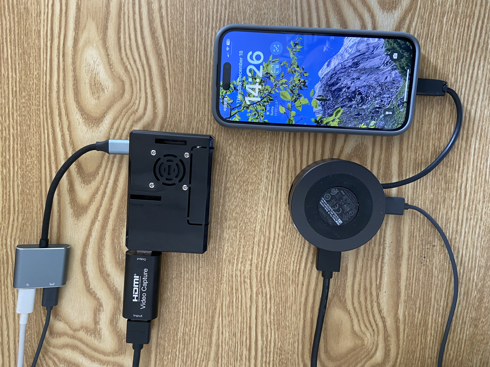
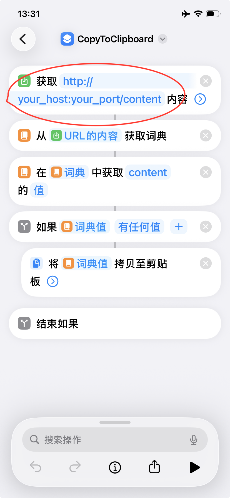
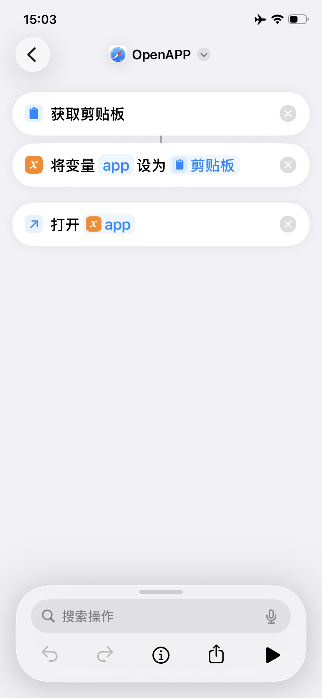

# 📱 Open iPhone Agent — Open iPhone Agent Framework

> This project is a secondary development based on the open-source projects **[Open-AutoGLM](https://github.com/zai-org/Open-AutoGLM)** and **[PiKVM](https://github.com/pikvm/pikvm)**. We pay tribute to the original projects.

> The model and inference configurations are referenced from and built upon the open-source Open-AutoGLM by Zhipu AI (Z.ai). The goal is to extend the capabilities of open-source multimodal large models to iPhone interaction scenarios, creating an extensible **iPhone Agent Framework** with replaceable underlying hardware to unlock "AI-driven iPhone automation" scenarios.

[](https://www.bilibili.com/video/BV1UDqpBTEcc)
---

## Current Status (Important)

* The project is in the **PoC (Proof of Concept) phase**.
* An **alternative to PiKVM** has been identified, which will optionally **remove the hardware dependency on PiKVM** in the future.
* Experimental validation has been completed on **iPhone 15 / 16 / 17**.
* Target audience: Developers, researchers, and engineering teams exploring iPhone automation.
> ⚠️ This project is for research and learning purposes only. It is strictly prohibited to use it for illegal information acquisition, system interference, or any unlawful activities. Please carefully review the Terms of Use (resources/privacy_policy.txt).
---

## Core Capabilities (What it does)

* Uses open-source **multimodal large models** (vision + text) to understand screens and plan actions.
* Chains **visual understanding → task planning → action generation** into executable commands.
* Implements actions such as text input, app launching/navigating via **iOS Shortcuts**.
* Supports natural language instructions (Chinese/English) and can run via third-party or locally deployed models (flexible).

---

## Architecture Overview

```
User Instruction (Text / Voice)
   ↓
AutoGLM-Phone (Local or Cloud Inference)
   ↓
iPhone Agent (Task Planning & Action Generation)
   ↓
PiKVM / Alternative (Video Capture + Keyboard/Mouse/OTG Input)
   ↓
iPhone (Shortcut Receives & Executes)
```

---

## Verified Environment

* iOS: **iOS 17.2.1 and above** (Tested models: iPhone 15/16/17)
* Recommended Model: **AutoGLM-Phone-9B** (including multilingual version)
* Supports multilingual scenarios including Chinese/English

---

## Hardware (Example Configuration — Replaceable)

> The following uses **Raspberry Pi 4B + PiKVM** as an example. Alternatives can be selected later to remove the dependency on this hardware.

**Hardware List**

* Raspberry Pi 4B (or other devices capable of running PiKVM)
* OTG adapter/module (for USB keyboard/mouse injection)
* HDMI capture card (for video capture)
* HDMI cable
* USB-C hub (must include USB and HDMI output)

**Connection Diagram**

1. Connect the iPhone via the USB-C hub.
2. Hub HDMI → HDMI capture card; USB → OTG adapter.
3. Connect the HDMI capture card to the Raspberry Pi (PiKVM).
4. The OTG module is used to inject keyboard/mouse input into the iPhone (or via an alternative injection method).
<p>
  
</p>
---

## Software & Models (Download)

| Model             | Download Links|
|-------------------|---------------|
| AutoGLM-Phone-9B  | [🤗 Hugging Face](https://huggingface.co/zai-org/AutoGLM-Phone-9B)<br>[🤖 ModelScope](https://modelscope.cn/models/ZhipuAI/AutoGLM-Phone-9B)|
| AutoGLM-Phone-9B-Multilingual | [🤗 Hugging Face](https://huggingface.co/zai-org/AutoGLM-Phone-9B-Multilingual)<br>[🤖 ModelScope](https://modelscope.cn/models/ZhipuAI/AutoGLM-Phone-9B-Multilingual)|

> **Thanks to Zhipu AI ([Z.ai](https://bigmodel.cn/)) for their open-source contribution to Open-AutoGLM.**

---

## Environment Setup

### System & Language

* Python **3.10+** recommended

### iPhone Side (Shortcuts)

* Install the required shortcuts on the iPhone: [OpenAPP](https://www.icloud.com/shortcuts/c2560bb5426449eda720b409f89627a7), [CopyToClipboard](https://www.icloud.com/shortcuts/f61c7bdd585a46de903852173620706e) (or custom equivalent shortcuts).
* Configure the server address in `CopyToClipboard` to your local/server `FastAPI` IP:PORT (used to receive content/commands from the Agent).
<div style="display:flex; gap:10px;">
  
  
</div>
---

## Quick Deployment Guide

### Install Project Dependencies

```bash
pip install -r requirements.txt
pip install -e .
```

### Start FastAPI Service (New terminal in project root)

```bash
uvicorn iphone_agent.fastapi_main:app --reload --host 0.0.0.0 --port 6666
```

---

## First Use (iPhone Accessibility & Keyboard Shortcut Configuration)

> To allow the Agent to simulate keyboard interactions, you need to enable related accessibility options on the iPhone and assign keyboard commands to shortcuts (a physical or Bluetooth keyboard may be required).

**Steps (in order)**

1. Settings → Accessibility → Touch → **AssistiveTouch**: Enable.
2. Settings → Accessibility → Keyboard & Input → **Full Keyboard Access**: Enable.
3. Prepare a physical or Bluetooth keyboard (for the initial configuration).
4. In **Full Keyboard Access → Commands**, bind keyboard shortcuts for common actions/shortcuts, e.g.:

   * Home Screen (corresponding command) → Bind `Alt + h`
   * Shortcut: `OpenAPP` → Bind `Alt + o`
   * Shortcut: `CopyToClipboard` → Bind `Alt + c`
5. Save and test: Press the bound key combination on the keyboard to confirm the iPhone triggers the corresponding shortcut/action.

> Note: The above key bindings are for illustration only. UI layouts may vary across iOS versions and devices. Please bind and test each item according to your actual interface.

---

## Model Service Deployment (Two Options)

You can choose: **Use a third-party model service (Recommended)** or **Deploy the model yourself (Local Inference)**.

---

### A. Use Third-Party Model Service (Recommended)

**1. Zhipu BigModel**

* For documentation and integration, refer to the official BigModel documentation.
* Example parameters:

```text
--base-url: https://open.bigmodel.cn/api/paas/v4
--model: autoglm-phone
--apikey: <your-bigmodel-api-key>
```

**2. ModelScope**

* Example parameters:

```text
--base-url: https://api-inference.modelscope.cn/v1
--model: ZhipuAI/AutoGLM-Phone-9B
--apikey: <your-modelscope-api-key>
```

**Usage Example**

```bash
python main.py \
  --base-url https://open.bigmodel.cn/api/paas/v4 \
  --model "autoglm-phone" \
  --apikey "your-bigmodel-api-key" \
  "Open Meituan and search for nearby hotpot restaurants"
```

---

### B. Deploy Model Yourself (Local / Private Cloud)

**Optional Inference Engines**

* **vLLM** (Recommended)
* **SGLang**

> For dependencies, please refer to the "For Model Deployment" section in `requirements.txt`.

**vLLM Startup Example (Recommended Parameters)**

```bash
python3 -m vllm.entrypoints.openai.api_server \
  --served-model-name autoglm-phone-9b \
  --allowed-local-media-path / \
  --mm-encoder-tp-mode data \
  --mm_processor_cache_type shm \
  --mm_processor_kwargs '{"max_pixels":5000000}' \
  --max-model-len 25480 \
  --chat-template-content-format string \
  --limit-mm-per-prompt '{"image":10}' \
  --model zai-org/AutoGLM-Phone-9B \
  --port 8000
```

**SGLang Startup Example**

```bash
python3 -m sglang.launch_server \
  --model-path zai-org/AutoGLM-Phone-9B \
  --served-model-name autoglm-phone-9b \
  --context-length 25480 \
  --mm-enable-dp-encoder \
  --mm-process-config '{"image":{"max_pixels":5000000}}' \
  --port 8000
```

> Note: The architecture of AutoGLM-Phone is identical to GLM-4.1V-9B-Thinking. For advanced optimization, refer to the GLM-V series documentation (model architecture, quantization, parallel strategies, etc.).

---

## Model Service Verification

Use the project's built-in script to verify the deployment:

```bash
python scripts/check_deployment_cn.py \
  --base-url http://<your-IP>:<port>/v1 \
  --model <model-name>
```

**Expected Log Snippet (Example)**

```text
<think>
User wants to compare the price of this shampoo on JD.com and Taobao...

<answer>
do(action="Launch", app="JD.com")
</answer>
```

> If the returned "chain of thought" is abnormally short or contains garbled text, it usually indicates a deployment or dependency configuration issue. Troubleshooting steps: Check dependency versions, model paths, inference engine startup parameters, and VRAM/resource limits.

---

## Usage Examples

### CLI Interaction

```bash
# Start interactive mode, connecting to local vLLM service
python main.py \
  --base-url http://localhost:8000/v1 \
  --model "autoglm-phone-9b"
```

```bash
# Directly let the Agent execute a task
python main.py \
  --base-url http://localhost:8000/v1 \
  "Open Meituan and search for nearby hotpot restaurants"
```

### English Prompt Example

```bash
python main.py \
  --lang en \
  --base-url http://localhost:8000/v1 \
  "Open Chrome browser"
```

### List Supported Apps

```bash
python main.py --list-apps
```

### Python API Quick Example

```python
from phone_agent import PhoneAgent
from phone_agent.model import ModelConfig

model_config = ModelConfig(
    base_url="http://localhost:8000/v1",
    model_name="autoglm-phone-9b",
)

agent = PhoneAgent(model_config=model_config)
result = agent.run("Open Taobao and search for wireless earbuds")
print(result)
```

---

## Common Issues & Troubleshooting

* **Model output is very short or garbled**: Check inference service logs, model paths, dependency versions, and VRAM.
* **iPhone does not respond to shortcuts**: Ensure "Full Keyboard Access" is enabled and shortcuts are correctly bound; try manually triggering them on a physical keyboard to test.
* **Video/Keyboard-Mouse not injecting**: Confirm HDMI capture and OTG module connections are correct; check the PiKVM (or alternative) service status and permissions.
* **Performance bottlenecks**: If using local deployment, prioritize checking VRAM, parallel parameters, and model quantization/sharding strategies (see vLLM/SGLang documentation).

---

## Future Plans (Roadmap)

1. Remove strong dependency on Raspberry Pi / PiKVM, providing pure software or more general hardware alternatives (currently in testing).
2. Expand supported apps (welcome submissions of App URL Schemes or PRs).
3. Optimize model and inference efficiency (quantization, caching, parallelism, etc.).
4. Enrich examples and automated test suites.
---

## Contribution & Contact

Feel free to submit issues, PRs, or reach out via the contact information in the README. If you have implemented new shortcuts, alternative input methods, or compatible devices, we greatly welcome contributions of examples and test results.
